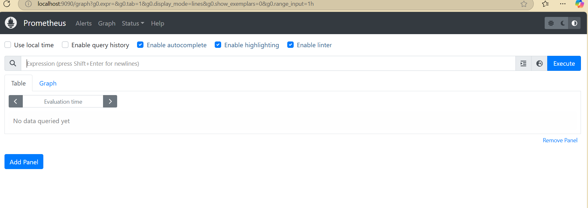
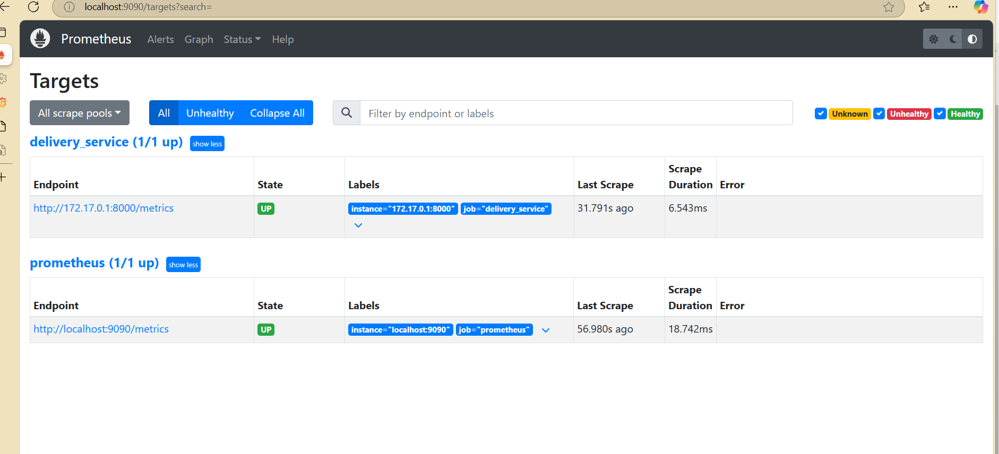
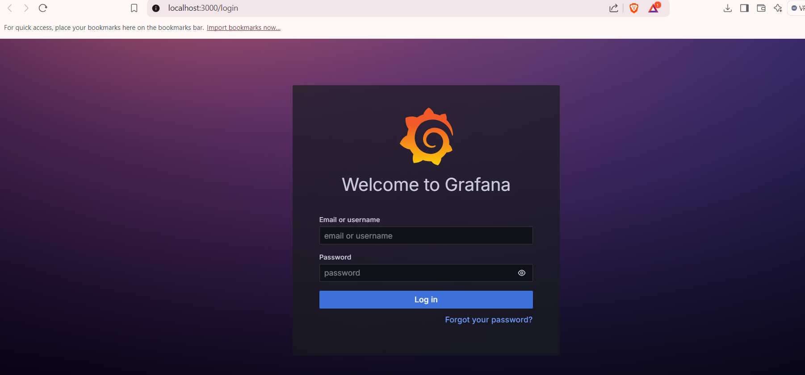
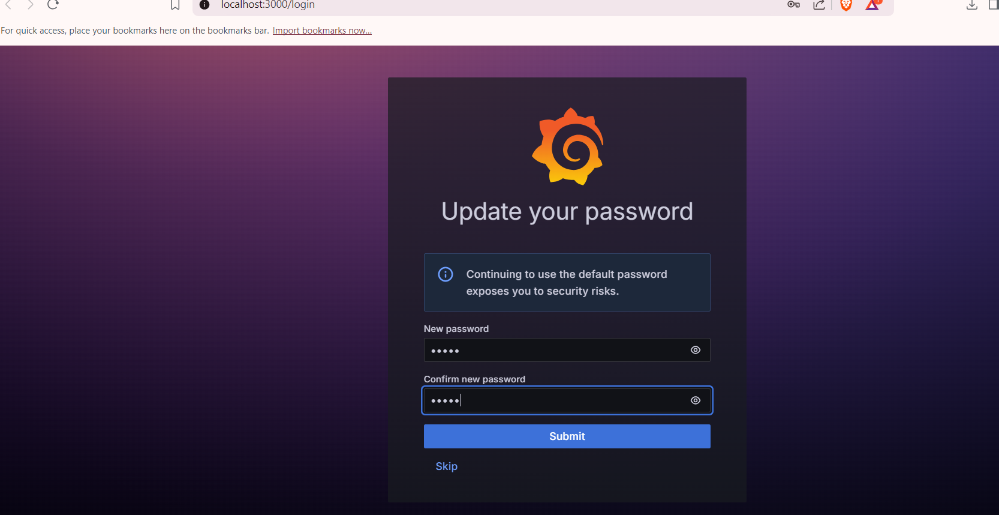
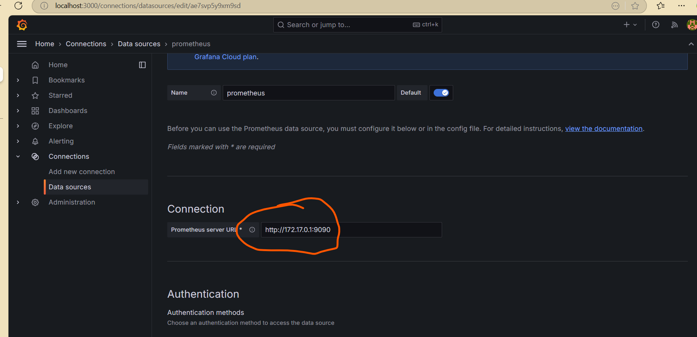

# Real-Time Operations Monitoring and Alerting

## Objective

Build a real-time monitoring solution for a delivery service (ZAPPTTO) to track delivery performance, visualize operational metrics, and detect problems quickly.

## Overview

This exercise uses **Python, Docker, Prometheus, Grafana, and Jenkins** to:

- Simulate delivery-service metrics.
- Expose application metrics for Prometheus to collect.
- Monitor delivery performance and pending deliveries.
- Display live metrics on a Grafana dashboard.
- Configure alerts for high pending deliveries and long average delivery times.
- Use a Jenkins pipeline to validate the Python application and build its Docker image.

## Prerequisites

- Docker Desktop
- Python 3.10 or higher
- Jenkins
- Prometheus
- Grafana
- Git and a code editor such as Visual Studio Code

## Project Files

The exercise directory contains the following files:

| File | Purpose |
|---|---|
| `delivery_metrics.py` | Simulates delivery activity and exposes metrics on port `8000`. |
| `requirements.txt` | Lists the Python package dependency, `prometheus-client`. |
| `Dockerfile` | Defines the Docker image for the Python delivery-metrics application. |
| `prometheus.yml` | Configures Prometheus scraping and the alert-rule file. |
| `alert_rules.yml` | Defines alert conditions for pending deliveries and average delivery time. |
| `docker-compose.yml` | Defines the delivery application, Prometheus, and Grafana services. |
| `Jenkinsfile` | Defines the Jenkins pipeline for checking Python syntax and building/verifying the Docker image. |

## Services and Local URLs

| Service | URL | Purpose |
|---|---|---|
| Delivery metrics | [http://localhost:8000/metrics](http://localhost:8000/metrics) | View metrics exposed by the Python application. |
| Prometheus | [http://localhost:9090](http://localhost:9090) | Query metrics and inspect targets and alerts. |
| Prometheus targets | [http://localhost:9090/targets](http://localhost:9090/targets) | Check whether Prometheus can scrape the configured targets. |
| Prometheus alerts | [http://localhost:9090/alerts](http://localhost:9090/alerts) | Inspect configured alert rules and their status. |
| Grafana | [http://localhost:3000](http://localhost:3000) | Build dashboards for delivery metrics. |
| Jenkins | [http://localhost:8080](http://localhost:8080) | Run and review the CI pipeline. |

## Metrics Monitored

- **Total deliveries** — total number of deliveries represented by the simulator.
- **Pending deliveries** — deliveries that are still waiting.
- **On-the-way deliveries** — deliveries currently in transit.
- **Average delivery time** — average observed delivery time, measured in seconds.

## Prometheus Alerts

The exercise includes these alert conditions:

- **HighPendingDeliveries:** triggers when pending deliveries remain above `10` for `15 seconds`.
- **HighAverageDeliveryTime:** triggers when the calculated average delivery time exceeds `30 seconds`.

Alert status can be checked in the Prometheus Alerts page.

## Grafana Dashboard

Configure Prometheus as Grafana's data source, then create dashboard panels for:

1. Total Deliveries
2. Pending Deliveries
3. On-the-Way Deliveries
4. Average Delivery Time

For the Prometheus data-source URL, use the address that is reachable **from the Grafana container**. In a Docker Compose setup where the services share a network, this is typically `http://prometheus:9090`.

### Screenshots
## Screenshots

### 1. Prometheus Main Page

### 2. Prometheus Targets

### 3. Prometheus Targets Running

### 4. Prometheus Alerts

### 5. Grafana Login Page

### 6. Grafana Login Password Update

### 7. Grafana Add Prometheus Data Source

### 8. Grafana Prometheus IP Address

### 9. Grafana Delivery Monitoring Dashboard

## Jenkins Pipeline

The `Jenkinsfile` automates the following checks:

1. **Check Workspace Files** — confirms the required project files are available.
2. **Check Python Syntax** — checks that `delivery_metrics.py` compiles successfully.
3. **Build Delivery App Image** — builds the Docker image for the application.
4. **Verify Docker Image** — confirms that the image was created.
5. **Post Actions** — reports whether the pipeline completed successfully or failed.

A successful Jenkins run should show all pipeline stages completed successfully.

## Expected Results

- The application exposes delivery metrics at `/metrics`.
- Prometheus collects the metrics and shows the delivery-service target as healthy.
- Prometheus evaluates the configured alert rules.
- Grafana displays delivery metrics in a dashboard.
- Jenkins completes the syntax check, Docker image build, and image verification stages.

## Notes

- Keep the filenames in this README aligned with the files in the exercise directory.
- Screenshot links use paths under `../Images/`; preserve those image filenames and the relative directory structure.
- The Jenkins pipeline requires Docker CLI and access to a working Docker daemon on the Jenkins agent.
